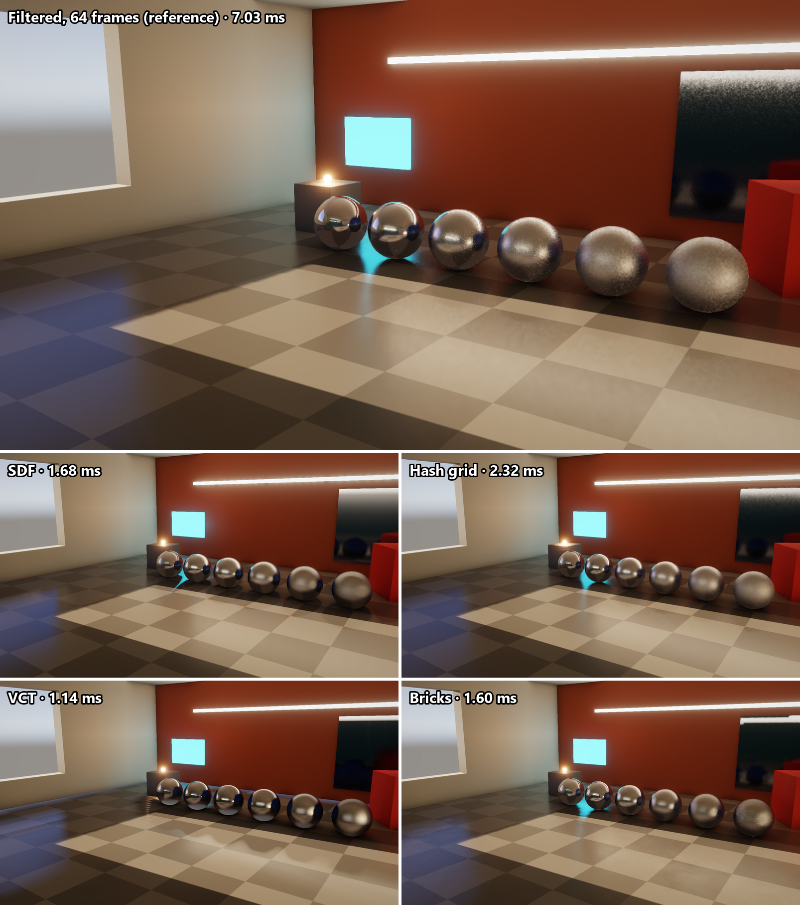

## Preface

I have been working on an acceleration structure for software ray tracing of static geometry, as an experiment in finding a faster way to draw world-space reflections of static objects.

In my rendering playground, "Strafe", I've put together some demos of different real-time reflection and GI methods.

For reflections: SSR, SDF sphere tracing, voxel cone tracing, a hash grid radiance cache, and a few others.

For GI: surfels, light propagation volumes, PRT, radiance cascades and SDFs. They're all compared against a path traced reference. This is mainly for learning, experimenting, and figuring out what to pursue.

> Disclaimer: A lot of the demos in Strafe are implemented with the help LLMs to help me iterate faster. The logic, techniques and ideas are all coming from me. I've pushed hard on optimizing each demo as much as I reasonably could, and while I'm sure there are some missed opportunities here and there, they're all generally as performant as I could get them without sacrificing visual fidelity.

In some of the research leading to these experiments, I came across some papers: [Layered Depth Images, Shade et al., '98](https://szeliski.org/papers/Shade_LayeredDepthImages_SG98.pdf) and [Image-Based Rendering for Non-Diffuse Synthetic Scenes](http://www0.cs.ucl.ac.uk/research/vr/Projects/VLF/vlfpapers/ibr/Lischinski_D__Image-Based_Rendering_for_Non-Diffuse_Synthetic_Scenes.pdf), Lischinski and Rappoport, '98

I worked some of these ideas into one of my earlier experiments, a "frozen hit cache": a big GPU hash table of ray hits, keyed by where the ray left from and a bin of directions, and lit every frame from cards around each object. That's where I landed on the current implementation of "bricks" for reflections.

I have also experimented with diffuse GI using this technique, but would like to focus on glossy reflections today.

## The structure

It works by splitting the scene into a grid of cells (say, 2m on a side). Each cell has up to three bricks, one per axis (X, Y, Z), and each brick is split further into a grid of columns running along its axis (32x32 by default, so a column is 6.25cm across).

You can then take the geometry of the scene and put each triangle in the brick of its normal's dominant axis, and in no other brick. Wherever it passes through one of that brick's columns, it creates a "crossing".

That gives us a guarantee that within a column, the surface's depth along the axis changes by at most one column width between the column's middle and its edge.
So a surface inside one column can be approximated by a single plane (a depth at the column's middle plus a normal).

A crossing can be described using two 32-bit words:
- a 16-bit depth and a 16-bit octahedral normal.
- a 16-bit 4x4 mask of which parts of the column the surface covers, and a 16-bit base color.

All the triangles of one surface in a column get merged into a single crossing. A column holds up to 8 crossings (sorted nearest first). Each tile of 4x4 columns stores the nearest and furthest depth in it.

To reach further out, the cells come in levels, like a clipmap. The levels can then follow the camera, and only the cells that come into view get rebuilt.

## How do we trace it?

A ray goes through three nested walks.
- Cells: A 3D DDA through the cells of a level (whichever is the finest level at that point along the ray). In each cell it visits whichever of the three bricks exist (X, Y or Z).
- Columns: Inside a brick, a 2D DDA across the columns, with the ray's position along the brick's axis tracked as it goes.
- Tiles: Before visiting a column, the ray checks its tile. If the tile is empty, or the depths the ray covers inside it miss the tile's nearest/furthest range, it jumps to the tile's far edge.

In a column, the ray intersects each crossing's plane, and keeps the hit if it lands in a part of the column that the mask says is covered. There's one small fudge: a plane still counts up to a quarter of a column past its own column. The planes of a curved surface don't quite meet, and without fudging it a bit, a ray can slip between them.

A hit returns the crossing's address, its brick and its normal.

## How we light the scene with it

Each brick has 8 "cards". These cards store radiance, with mips, of the light its crossings send on. They're split by which way the crossings face, and into four layers through the brick's depth.

A hit reads its card where it landed, at a mip as wide as the reflection's lobe is at that distance, which also blurs rough reflections for free.

## Caching hits

Because every crossing has an address, ray hits can be stored against the surface they left from, with no hashing at all. Each crossing owns four "slots". A slot is the hit of one ray in a bin of directions (the bin size is picked by roughness), which gives us the card the ray landed on, and how far away it was.

A pixel finds the crossing it's on, reads the four slots around its reflected direction, and reads the cards they name. Missing slots get requested (one request per crossing per frame) and traced at the start of the next frame. Neighbouring pixels read neighbouring columns, so it's all very coherent.

-----

## Pros/cons

Upsides:
- Empty space skipping. Empty bricks are skipped whole, and because each tile stores its min/max depths, we can skip a lot of the time we'd spend marching and cut right to the chase.
- Accurate hits. Inside a column, a hit lands on an actual plane, not a voxel face or an SDF surface, so surfaces don't come out blocky and thin walls stay thin.
- We can cache a lot, coherently. A hit is stored against the crossing the ray left from, as the card it landed on, so lighting a cached hit is just a texture read.

Downsides:
- Only static geometry. Moving objects aren't in the bricks, so they don't show up in brick rays and don't cast shadows into the cached light.
- Memory usage. Not *too* bad compared to, say, a dense SDF volume, since empty space costs a word per brick and the rest grows with surface area rather than volume. But that memory still has to come from somewhere.
- Curved things. Each column only gets a plane, so curved surfaces need the fudge above, and pixels on them often need rays of their own instead of the cache.
- Limits on detail. A column holds at most 8 crossings, and the coverage mask works in quarters of a column (~1.6cm at the finest level, doubling with each level out).
- You still need some way of building the structure. Having an existing BVH to trace against for building it gives the best results. Rasterization works, but with some gaps: anything thinner than a quarter of a column can slip through.
- Mean squared error is higher than other techniques. It looks good, but there are definitely differences compared to the path traced reference.

-----

## Comparison against other techniques

### Performance and RelMSE

|Technique | relMSE @64	| capped @64	| GPU ms
|---|---:|---:|---:|
|IBL	|0.161	|0.161	|0.05
|naive	|1.226	|0.332	|6.56
|SDF	|0.080	|0.030	|1.94
|bricks	|0.224	|0.046	|1.47

### Legend:

| Technique Name | Description |
|---|---|
| ibl | Split-sum lookup into the prefiltered sky. No rays at all. |
| naive | One GGX VNDF ray per pixel per frame, with no denoising. |
| sdf | Sphere tracing a distance field baked from the static geometry, with hits shaded from a relit radiance volume. |
| bricks | This article. |

<!-- 

## Comparison with Layered Depth Cubes:

| | Layered Depth Cube | Bricks |
|---|---|---|
| Surface goes into | all three axes | one axis (dominant normal) |
| Sample | point | plane + 4x4 coverage mask |
| Extent | whole scene per LDI | 2m cells, up to 6 levels |
| Ray walk | each LDI separately, quadtree skip | one cell walk, all axes per cell, tile skip |
| Lighting | baked into samples | relit cards |
| Glossy / rough | layered light field gather | card mips |
| Hit caching | none | slots per crossing per direction bin |
| Build | offline, CPU ray casting | GPU, incremental | -->
