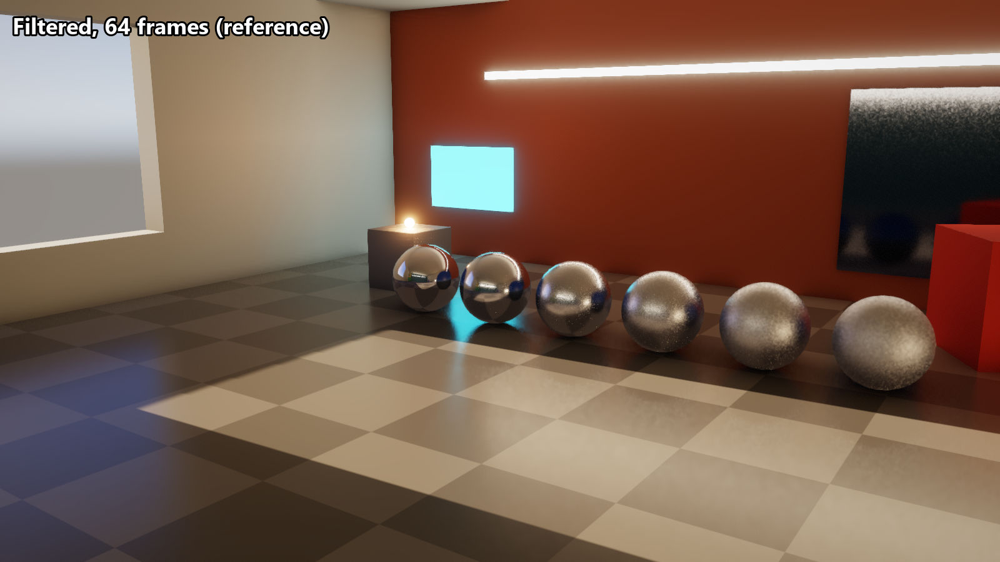
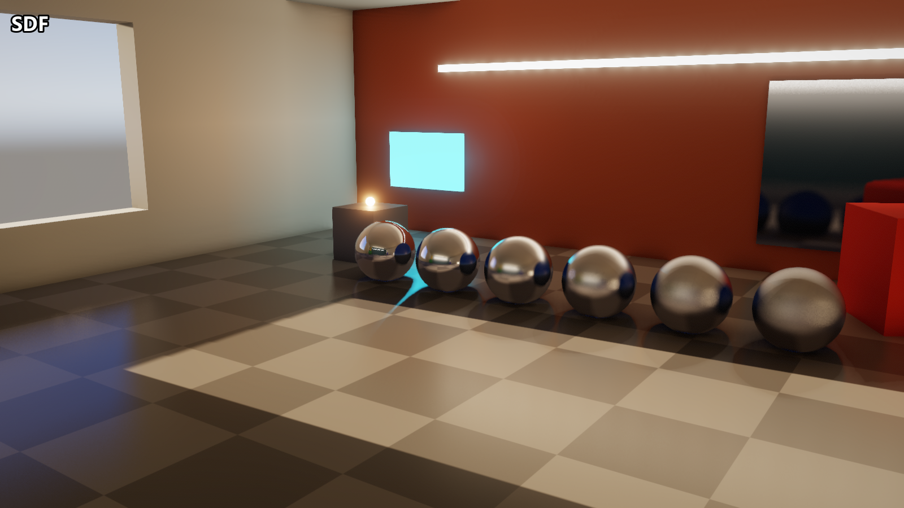
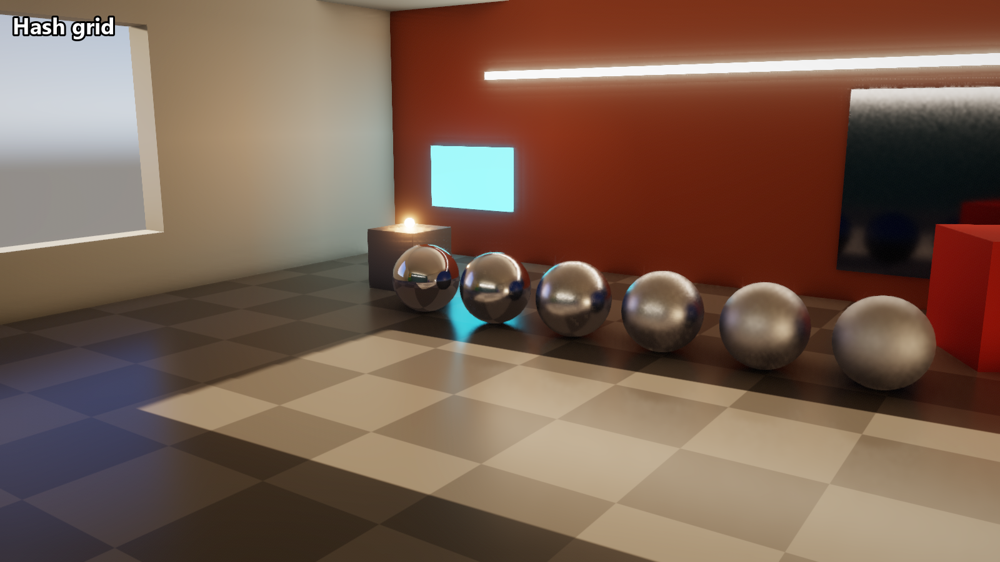
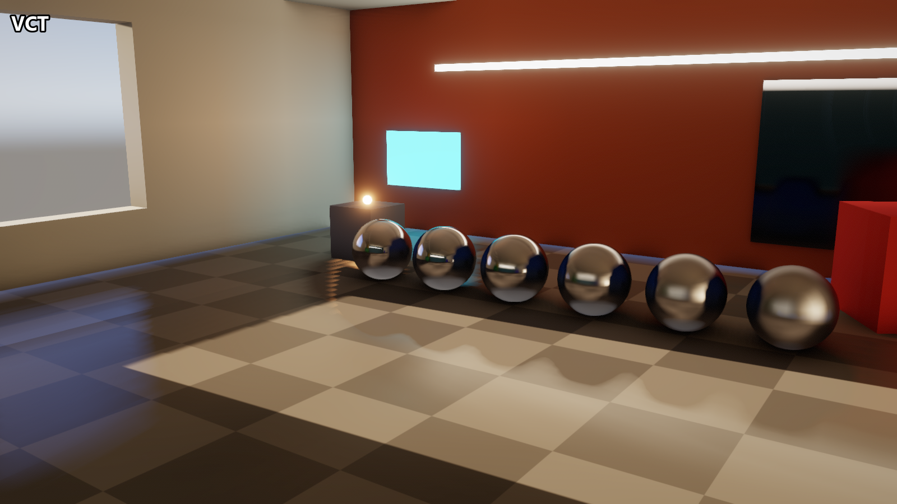
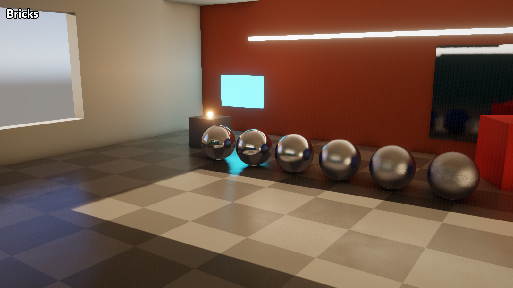

## Preface

I have been working on an acceleration structure for software ray tracing of static geometry, as an experiment in finding a faster way to draw world-space reflections of static objects.

In my rendering playground, "Strafe", I've put together some demos of different real-time reflection and GI methods.

For reflections: SSR, SDF sphere tracing, voxel cone tracing, a hash grid radiance cache, and a few others.

For GI: surfels, light propagation volumes, PRT, radiance cascades and SDFs. They're all compared against a path traced reference. This is mainly for learning, experimenting, and figuring out what to pursue.

> Disclaimer: A lot of the demos in Strafe are implemented with the help LLMs to help me iterate faster. The logic, techniques and ideas are all coming from me. I've pushed hard on optimizing each demo as much as I reasonably could, and while I'm sure there are some missed opportunities here and there, they're all generally as performant as I could get them without sacrificing visual fidelity.

In some of the research leading to these experiments, I came across some papers: [Layered Depth Images, Shade et al., '98](https://szeliski.org/papers/Shade_LayeredDepthImages_SG98.pdf) and [Image-Based Rendering for Non-Diffuse Synthetic Scenes](http://www0.cs.ucl.ac.uk/research/vr/Projects/VLF/vlfpapers/ibr/Lischinski_D__Image-Based_Rendering_for_Non-Diffuse_Synthetic_Scenes.pdf), Lischinski and Rappoport, '98

I worked some of these ideas into one of my earlier experiments, a "frozen hit cache": a big GPU hash table of ray hits, keyed by where the ray left from and a bin of directions, and lit every frame from cards around each object. That's where I landed on the current implementation of "bricks" for reflections.

I have also experimented with diffuse GI using this technique, but would like to focus on glossy reflections today.

## The structure

It works by splitting the scene into a grid of cells (say, 2m on a side). Each cell has up to three bricks, one per axis (X, Y, Z), and each brick is split further into a grid of columns running along its axis (32x32 by default, so a column is 6.25cm across).

You can then take the geometry of the scene and put each triangle into the bricks of its normal's dominant axis only (in every cell it touches, but never into a brick of another axis). Wherever it passes through one of that brick's columns, it creates a "crossing".

That gives us a guarantee that within a column, the surface's depth along the axis changes by at most one column width between the column's middle and its edge.
So a surface inside one column can be approximated by a single plane (a depth at the column's middle plus a normal).

A crossing is described by two 32-bit words, which is all the trace has to read:
- a 16-bit depth and a 16-bit octahedral normal.
- a 16-bit 4x4 mask of which parts of the column the surface covers, and a 16-bit (RGB565) base color.

Two more words sit off to the side for shading (material, metallic, roughness and a few flags), so a crossing is 16 bytes in all.

All the triangles of one surface in a column get merged into a single crossing: pieces merge when their depths at the column's middle are within half a column of each other and their normals are within about 37°. A column holds up to 8 crossings (sorted nearest first). Each tile of 4x4 columns stores the nearest and furthest depth in it.

To reach further out, the cells come in levels, like a clipmap: up to six, each with cells twice the size of the last. The levels follow the camera, and only the cells that enter a level's window get rebuilt, 32 cells a frame.

## How do we trace it?

A ray goes through three nested walks.
- Cells: A 3D DDA through the cells of a level (whichever is the finest level at that point along the ray). In each cell it visits whichever of the three bricks exist (X, Y or Z).
- Columns: Inside a brick, a 2D DDA across the columns, with the ray's position along the brick's axis tracked as it goes.
- Tiles: Before visiting a column, the ray checks its tile. If the tile is empty, or the depths the ray covers inside it miss the tile's nearest/furthest range, it jumps to the tile's far edge.

In a column, the ray intersects each crossing's plane, and keeps the hit if it lands in a part of the column that the mask says is covered.

There's one small fudge needed to make it work because planes of a curved surface don't quite meet, and without it a ray can slip between them. So a plane still counts up to a quarter of a column past its own column. 

A hit returns the crossing's address, its brick and its normal.

## How we light the scene with it

Each brick has 8 "cards". These cards store radiance of the light its crossings send on: one texel per column (32x32), with a full mip chain. They're split by which way the crossings face, and into four layers through the brick's depth. Only cards with something on them get a picture.

Cards are relit in the background, an eighth of the non-empty bricks each frame, so a full round takes 8 frames. Relighting adds up the sun (behind a shadow ray), the emitters, and the diffuse light around it (from the scene's light probes).

A hit reads its card where it landed, at a mip as wide as the reflection's lobe is at that distance, which also blurs rough reflections for free.

## Caching hits

Because every crossing has an address, ray hits can be stored against the surface they left from, with no hashing at all. Directions are split into bins (picked by roughness), and each crossing owns four *slots* for them. A slot is the hit of one ray in one bin: `the card the ray landed on, and how far away it was`.

The four slots hold the 2x2 bins around the direction the crossing reflects the eye in. As the view moves, new bins are requested and the oldest are evicted. A pixel finds the crossing it's on, reads its slots, and reads the cards they name. Missing slots get requested and traced at the start of the next frame. Neighbouring pixels read neighbouring columns, so it's all very coherent.

Not every pixel can be cached. Pixels on curved crossings, pixels whose own reflected direction strays too far from their crossing's, and pixels with no crossing at all such as moving objects trace rays of their own through the bricks.

-----

## Pros/cons of the technique, so far.

Upsides:
- Empty space skipping. Empty bricks are skipped whole, and because each tile stores its min/max depths, we can skip a lot of the time we'd spend marching and cut right to the chase.
- Accurate hits. Inside a column, a hit lands on an actual plane, not a voxel face or an SDF surface, so surfaces don't come out blocky and thin walls stay thin.
- We can cache a lot, coherently. A hit is stored against the crossing the ray left from, as the card it landed on, so lighting a cached hit is just a texture read.

Downsides:
- Only static geometry. Moving objects aren't in the bricks, so they don't show up in brick rays and don't cast shadows into the cached light.
- Memory usage. Not *too* bad compared to, say, a dense SDF volume. But that memory still has to come from somewhere.
- Curved surfaces. If you have a scene with a lot of curved surfaces it can quickly eat up frame time. Each column only gets a plane, so curved surfaces need the 'fudge' mentioned above, and those pixels need rays of their own instead of being able to use the cache.
- You still need some way of building the structure. Having an existing BVH to trace against for building it gives the best results. Rasterization works, but with some gaps: anything thinner than a quarter of a column can slip through, and rasterized bricks can't follow the camera.
- Error is higher than the best techniques. It looks good, but there are definitely differences compared to the path traced reference, and a few pixels with large errors push its uncapped relMSE up a lot (see the table below).

-----

## Comparison against other techniques

The same frame for each technique, 64 frames after the camera stopped, with the scene's own roughness. The first image is `filtered`, which gets close enough to the path traced reference to stand in for it.

### Performance and relMSE

All numbers are at 1600x900 with Vulkan validation off, in the room scene shown above. Lighting includes diffuse GI from light probes.

#### RTX 5070 Laptop GPU (Windows)

| Technique | GPU ms | GPU MB | relMSE @1 | @16 | @64 | Bias | After fly-in @4 | Capped @64 |
|---|---:|---:|---:|---:|---:|---:|---:|---:|
| filtered (reference) | 7.63 | 113 | 0.029 | 0.008 | 0.007 | 0.005 | 0.033 | 0.007 |
| hashgrid | 2.46 | 154 | 0.017 | 0.006 | 0.005 | 0.005 | 0.033 | 0.005 |
| sdf | 1.73 | 97 | 0.144 | 0.127 | 0.126 | 0.126 | 0.118 | 0.069 |
| vct | 1.09 | 84 | 0.081 | 0.081 | 0.081 | 0.081 | 0.081 | 0.074 |
| **bricks** | 1.44 | 34 | 0.245 | 0.208 | 0.207 | 0.206 | 0.206 | 0.035 |

#### MacBook Pro M1 (macOS, MoltenVK)

The same benchmark with the same settings, on an M1 MacBook Pro (16 GB) through MoltenVK.

| Technique | GPU ms | GPU MB |
|---|---:|---:|
| filtered (reference) | 69.29 | 102 |
| hashgrid | 24.89 | 143 |
| sdf | 17.47 | 105 |
| vct | 13.73 | 105 |
| **bricks** | 10.60 | 33 |

### Legend: techniques

| Technique | Description |
|---|---|
| filtered | One GGX VNDF ray per pixel per frame, accumulated over frames in a reprojected history, then an edge-stopping blur whose width follows the reflection's lobe. Used as the reference here. |
| hashgrid | The same accumulated rays, but hits are shaded from a world-space hash grid that caches sunlight, so most need no shadow ray. |
| sdf | Sphere tracing a distance field baked from the static geometry, with hits shaded from a relit radiance volume. |
| vct | Voxel cone tracing through a camera-centred clipmap of opacity and radiance. |
| bricks | This article. |

### Legend: columns

| Column | What it means |
|---|---|
| GPU ms | Time spent in the technique's own GPU passes, averaged over the last half of a 64-frame run. Building the bricks isn't included. |
| GPU MB | GPU memory the technique allocates for itself. Things every technique shares such as the scene's BVH, textures, the G-buffer aren't included in this number |
| relMSE @N | Relative mean squared error against the path traced reference, N frames after the technique's history is reset with the camera held still. Only glossy surfaces (roughness 0.65 or lower) are counted. Lower is better. @1 shows how a technique does with no history at all, @64 once it has settled. |
| Bias | The error of the average of all 64 frames |
| After fly-in @4 | The error 4 frames after the camera flies into the view from nearby, rather than starting still. Shows how well a technique reuses its past frames when the camera moves. |
| Capped @64 | Same as @64, but with each pixel's error capped at 10 before averaging. A few fireflies or very wrong pixels can dominate relMSE, so this shows how close the image is overall |

<!-- 

## Comparison with Layered Depth Cubes:

| | Layered Depth Cube | Bricks |
|---|---|---|
| Surface goes into | all three axes | one axis (dominant normal) |
| Sample | point | plane + 4x4 coverage mask |
| Extent | whole scene per LDI | 2m cells, up to 6 levels |
| Ray walk | each LDI separately, quadtree skip | one cell walk, all axes per cell, tile skip |
| Lighting | baked into samples | relit cards |
| Glossy / rough | layered light field gather | card mips |
| Hit caching | none | slots per crossing per direction bin |
| Build | offline, CPU ray casting | GPU, incremental | -->
